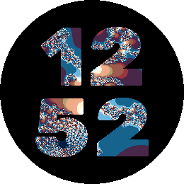
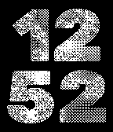

# Escape Time

A Pebble watch face: the time in four large digits and a dive into the
Mandelbrot set. The digits are part of the set: white strokes whose bands
flow outward with the fractal's, fine where the dive is shallow, bold where
it is deep, swelling in waves as the colors move. B&W watches show the same
face, dithered. The name is the algorithm's: the escape-time algorithm
colors each point by how many steps it takes to escape.

- **The hour picks where to dive:** twelve targets spread around the set,
  repeated twice a day; odd hours dive into the mirror image.
- **The minute sets how deep:** at :00 the whole set, then 1.2x deeper every
  minute, to about 47,000x at :59.
- **It moves by color cycling:** the view is computed once a minute and the
  palette flows through it, so animating costs almost nothing. The digits'
  outline moves with it.

An hour on the watch, one frame per minute (16:00-16:59, the dive into the
Northwest star; every frame is the watch's own rendering):

| basalt | emery | gabbro | diorite |
|---|---|---|---|
|  |  |  |  |

The emery and gabbro images are rendered by `tools/preview.py`; basalt and
diorite are emulator screenshots, which match their previews pixel for
pixel. See
[docs/design](docs/design/README.md) for the design brief.

## How it works

- **Fixed point.** Pebble apps build for a Cortex-M3 without hardware
  floating point, so `src/c/mandel.c` iterates in Q4.27 (int32, 27 fraction
  bits) with 64-bit products. That resolution (7.5e-9) still leaves dozens
  of units per pixel at the deepest minute, which is why the dive is an hour
  of 1.2x steps. A cardioid/bulb test and Brent's cycle check (cycles are
  exact in fixed point) end points inside the set early.
- **Targets with endless detail.** Each hour dives into a Misiurewicz point
  (a c whose critical orbit lands on a cycle after a few steps), found with
  `tools/find_targets.py`, or Seahorse Valley's classic deep-zoom point. The
  set is self-similar around Misiurewicz points, so a dive never ends in a
  flat interior.
- **Zooming about the target.** The view's center approaches the target as
  the step shrinks (`src/c/dive.c`), so the target stays fixed in the window.
- **Spread over frames.** A new minute's view is computed a row at a time
  within a 40 ms budget per frame, interlaced (every 8th row first), so it
  sharpens evenly over the old one (`src/c/grid.c`). Measured in the basalt
  emulator: 130-250 ms per view of the whole screen.
- **Digits as distance fields.** Each digit is a few centre lines
  (`tools/glyphs.py`). The watch stores, per digit, the distance from every
  point nearby to those lines, sampled every 2 px; a pixel is digit when its
  (bilinearly interpolated) distance is under its stroke radius. The radius
  comes from the pixel's cell: its depth (where its escape count ranks in
  the view) and a triangle wave riding the palette phase. Both are looked up
  per frame in 256-entry tables (`src/c/face.c`), so the shape changes every
  frame for a subtraction and a few compares per pixel. Past the stroke: a
  black keyline, then bands that flow out of the digit.
- **Lace.** Deep in the dive, filaments are finer than a pixel and their
  colors turn to confetti. A cell whose escape count jumps by more than 6
  from its left neighbour's is drawn in one steady color instead.
- **B&W.** The same shading gives each pixel a level instead of a color: the
  palette's lightness on the color screen, scaled to 1-11 of 16 so solid
  white stays the digits', dithered with a 4x4 Bayer pattern
  (`src/c/paint.c`).
- **Memory.** One byte per cell of the screen: 1 px cells (24 KB on basalt,
  46 KB on emery, 68 KB on gabbro) plus the distance field (6 KB on basalt).
  Aplite's 24 KB only fits 2 px cells (6 KB); the digits stay sharp, as
  their distances are per pixel.

The layout and Quick View handling come from
[Hearth](https://github.com/graus/hearth-pebble-watchface).

## Building and previewing

    python3 tools/build_assets.py     # digits, palette, targets, icon
    pebble build
    make -C tools/host test           # the engine on the host
    python3 tools/preview.py          # faces at any time, into preview/
    python3 tools/build_store_assets.py  # store timelapses, stills, icons, banner
    store/publish.sh                  # publish to the Pebble app store (goes live)

`tools/design.py` holds the palette, B&W levels, stroke weights and
targets; `tools/glyphs.py` the digit shapes. `tools/preview.py`
renders with the watch's own C code (compiled for the host), so previews
match the watch pixel for pixel, at any time of day; `-screen` images
simulate the color display's muted gamut (`tools/display.py`).

## License

MIT.
